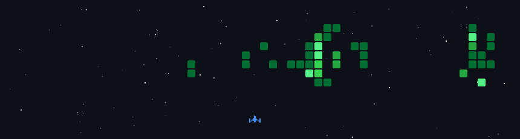

<p align="center">
  
</p>

<div align="center">


<br/>

    
<br/>
    
</div>


## `> whoami`

<div align="center">
  
</div>

```bash
$ cat ferr.txt

  nombre   →  Ferr (Fernanda)
  estudio  →  Programación + Ciberseguridad @ INACAP, Chile
  enfoque  →  apps web seguras por defecto: tests, CI y análisis de seguridad
  interés  →  CTF, hacking ético, AppSec y desarrollo web
  hobbies  →  arte digital, gaming, música
  estado   →  siempre aprendiendo...
```


## `> stack`

<div align="center">


<br/>


<br/>


</div>


## `> currently learning`

<div align="center">


</div>


## `> stats`

<div align="center">


</div>


## `> proyectos destacados`

<table>
<tr>
<td width="50%" valign="top">

### 🤖 [Nexo CRM](https://github.com/Fernandamv96/nexo-crm)
CRM con pipeline kanban y un copiloto con IA (Claude) que responde preguntas y mueve negocios con *tool use*.


[`demo →`](https://fernandamv96.github.io/nexo-crm/) · [`repo →`](https://github.com/Fernandamv96/nexo-crm)
</td>
<td width="50%" valign="top">

### 📦 [ERP Pyme](https://github.com/Fernandamv96/erp-pyme)
ERP para pymes con ventas, inventario, clientes y gastos, con login de administrador.


-FF79C6?style=flat-square&logo=postgresql&logoColor=white)


[`demo →`](https://erp-pyme-rho.vercel.app) · [`repo →`](https://github.com/Fernandamv96/erp-pyme)
</td>
</tr>
<tr>
<td width="50%" valign="top">

### 🛍️ [Retail](https://github.com/Fernandamv96/retail)
Tienda con catálogo y panel CRUD protegido por login, en Django 6.


-FF79C6?style=flat-square&logo=postgresql&logoColor=white)

[`demo →`](https://retail-red.vercel.app) · [`repo →`](https://github.com/Fernandamv96/retail)
</td>
<td width="50%" valign="top">

### 🏗️ [Cotizador Cintac](https://github.com/Fernandamv96/cintac-cotizador)
Cotizador de fletes de importación marítima para Comex: compara embarcadores, calcula costos de internación y exporta a PDF.


[`demo →`](https://cintac-cotizador.vercel.app) · [`repo →`](https://github.com/Fernandamv96/cintac-cotizador)
</td>
</tr>
<tr>
<td width="50%" valign="top">

### 🏥 [Clínica: API de pacientes](https://github.com/Fernandamv96/Clinica-registro-pacientes)
API REST de pacientes e historial clínico, con JWT y control de acceso por rol.


[`repo →`](https://github.com/Fernandamv96/Clinica-registro-pacientes)
</td>
<td width="50%" valign="top">

### 💉 [Wiki de Inyección SQL](https://github.com/Fernandamv96/wiki-sql-injection)
Wiki educativa sobre SQLi, con simulación segura de *payloads* y guía de prevención.


[`demo →`](https://wiki-inyecci-n-sql-c96e.vercel.app) · [`repo →`](https://github.com/Fernandamv96/wiki-sql-injection)
</td>
</tr>
</table>

<p align="center"><a href="https://fernandamv96.github.io">ver todos los proyectos en mi portafolio →</a></p>


## `> snake`

<div align="center">

<picture>
  <source media="(prefers-color-scheme: dark)" srcset="https://raw.githubusercontent.com/Fernandamv96/Fernandamv96/output/github-contribution-grid-snake-dark.svg">
  
</picture>

</div>


## `> space shooter`

<div align="center">



</div>


## `> contacto`

<div align="center">

[](https://www.linkedin.com/in/fernanda-mv-b50367332/)
[](https://fernandamv96.github.io)
[](https://github.com/Fernandamv96)
[](https://open.spotify.com/user/3172sdkmnqoucgtdmsmun6nl6xf4)

*escuchando lo que sea que me mantenga en modo focus* 🎧

</div>


## `> visitas`

<div align="center">


</div>

## `> trofeos`

<div align="center">

[](https://github.com/Fernandamv96)

</div>


## `> activity`

<div align="center">

[](https://github.com/ashutosh00710/github-readme-activity-graph)

</div>

## `> streak`

<div align="center">

[](https://git.io/streak-stats)

</div>


<div align="center">

</div>
